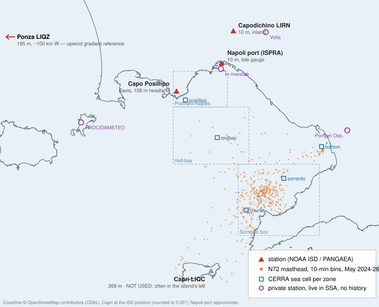
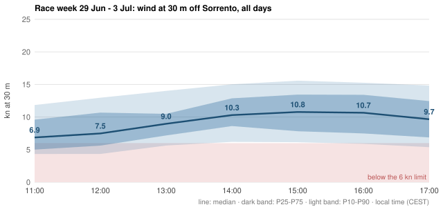
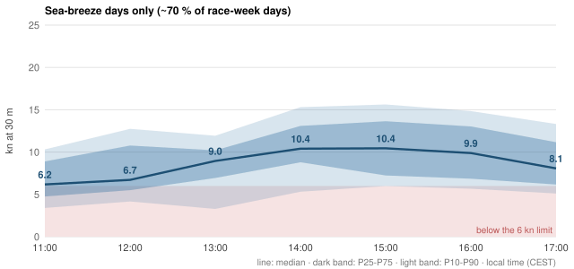
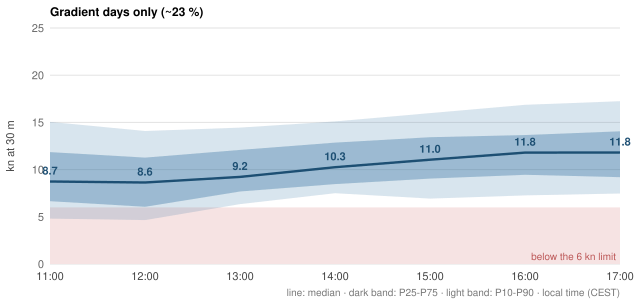
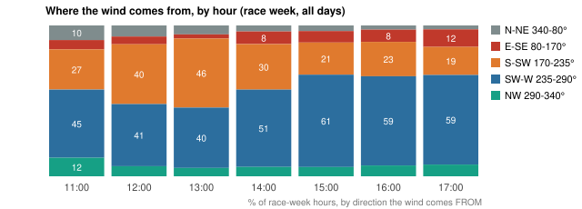
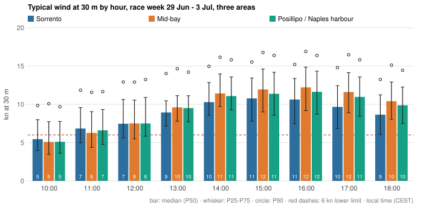
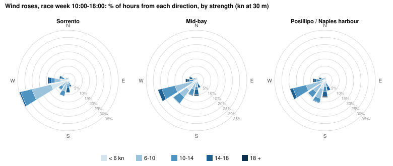

# Bay of Naples: race-week wind, 29 June – 3 July

*Results · 26 Nov 2026 · for the 2027 maxi regatta · wind at 30 m over the course, 11:00–17:00 local (CEST)*

## The answer in one page

**The most likely race afternoon is a sea breeze.** It is light at the start: **about 7 kn at 11:00**, from the
S–SW. It **builds to 10–11 kn by 14:00–16:00** from **220–230°**, and is still about 10 kn at 17:00. Gusts at
the masthead run **1.2× the mean** (10-minute peak over 10-minute mean).

| | |
|---|---|
| Typical afternoon, 14:00–16:00 (median) | **10–11 kn** at 30 m, from SW (220–230°) |
| Middle half of afternoons (P25–P75) | 8–13 kn |
| A windy race-week afternoon (P90) | 15–16 kn |
| Chance a given race day is race-able (≥ 3 hours inside 6–25 kn) | **90 %** (90 % interval 79–100 %) |
| Chance of racing on at least 4 of the 5 days | **91 %** (70–100 %) |
| Chance of racing on all 5 days | **59 %** (32–98 %) |
| Days lost per regatta, on average | **0.5** |
| The real risk | **too LITTLE wind before 13:00.** Over 25 kn essentially never happens in race week |

**What kind of day to expect.** These are race-week odds from ERA5's 21 summers, 2006–2026.

| weather type | share of race-week days | what it looks like at 30 m |
|---|---|---|
| **Sea breeze** | **70 %** | 6 kn at 11:00 building to 10–11 kn by 14:00, from 220–230° |
| Sea breeze on a gradient | 5 % | the same shape, about 1 kn stronger |
| Gradient | 23 % (S–SW 9, NW 8, N–NE 7) | 9 kn at 11:00 building to 12 kn, steadier; the windiest days |
| No breeze | 3 % | 8–9 kn, N–NE turning NW: the land wind that kept the breeze off |

**Three things this study cannot yet say well.** These are spelled out in §7.
- **July versus May** is not measurable from the stations. They disagree with each other about the sign.
- **The masthead has only 11 sea-breeze days**, and only one of them was an SE-morning day.
- **Nothing measured 30 m in July.** Every 30 m speed comes from May, and only the share of each weather type comes from July.

### How to read P10, P25, P50, P75 and P90

Take one hour, say 15:00 off Sorrento. Imagine every race-week afternoon from the last 21 summers lined up
in a row, from the lightest at 15:00 to the windiest. The percentiles are places in that row.

| | what it means | 15:00 off Sorrento |
|---|---|---|
| **P50 (the median)** | **The typical day.** Half the days are lighter than this and half are windier. It is the "most likely" number used in the charts. | **10.8 kn** |
| **P25** | One day in four is lighter than this. | 7.8 kn |
| **P75** | One day in four is windier than this. | 13.4 kn |
| **P25 to P75** | **The middle half of the days**: what you will normally get. Expect to be inside this range on about every other day. | 7.8–13.4 kn |
| **P90** | Only one day in ten is windier. This is a properly windy afternoon *for this venue in this week*: the top of the range worth planning sails for. | 15.6 kn |
| **P10** | Only one day in ten is lighter: the near-drifter. | 6.1 kn |

These describe the **season**, not any one day. On the morning of a race, the forecast replaces them (§8).
What the percentiles tell you is how far a forecast for that day sits from normal.

## 1. How the numbers were made

The 30 m wind on a race day depends first on **which kind of day it is**, so the study splits the problem in
two.

1. **How often each kind of day happens** in race week comes from the ERA5 reanalysis over 21 summers,
   2006–2026. The rule uses only ERA5 (850 and 925 hPa wind, the land–sea temperature contrast, the low-level
   stability) and was checked against the 19 Northstar 72 days: it agrees on 18. Details are in the plan, §5.3.
2. **The wind on each kind of day** comes from the best source for that kind of day:
   - **Sea-breeze days: Northstar 72's masthead** (32 m, 10-minute bins, May 2024–26). No reanalysis knows
     *which* afternoon fills to 15 kn and which stalls at 6. Against the masthead their hour-to-hour
     correlation is 0.1, so on these days the masthead *is* the wind. The boat raced mostly 12:00–15:00, so
     only 5 of its 11 sea-breeze days have an 11:00 hour, and only one has 16:00 or 17:00. A missing hour is
     that day's nearest sailed hour, scaled by the July sea-breeze curve of the two bay stations that sample
     every hour (Napoli port and Capodichino). The **level** is the masthead's and the **shape** is the
     stations'.
   - **Every other day: ERA5 at the course**, lifted to 32 m and corrected by the **+2.2 kn** it reads low
     against the masthead on gradient days (+2.7 in 2024, +1.5 in 2025). Each of those days is a real
     historical day, so its hours keep their own shape.
3. **May → July.** The masthead's sea-breeze days are all in May. They are multiplied by a factor F, drawn
   anew for every simulated week across the range the bay's stations measure (§4).
4. **Race weeks** are whole historical weeks: each summer's actual five-day sequence of weather, for the real
   29 Jun – 3 Jul and for the same week shifted by −15 to +15 days in 3-day steps. That gives 231 weeks.
   Spells of the same weather are kept, rather than treating the five days as independent.
5. **Uncertainty** comes from a bootstrap that resamples summers and masthead days together, 500 times.
   Every "90 % interval" here is from that bootstrap.

```html

```

*What the study measures with.*
- **Orange dots:** the masthead's 444 ten-minute bins.
- **Red triangles:** stations with a record.
- **Grey triangle:** Capri, which is not used (see below).
- **Purple circles:** private stations SSA reads live but which have no history.
- **Blue squares:** the CERRA sea cell used for each zone.

**Capri is not used for any speed or ratio.** From local observation it is often in the island's lee and
does not see the sea breeze. Its numbers are still computed, and its July/May ratio (0.97) falls inside the
range of the others, but it does not vote.

## 2. Race-week wind by hour (Q1)

```html

```

| local | P10 | P25 | **P50** | P75 | P90 | inside 6–25 kn | below 6 | ≥ 12 kn | ≥ 16 kn |
|---|---|---|---|---|---|---|---|---|---|
| 11:00 | 4.3 | 5.0 | **6.9** | 9.6 | 11.8 | 63 % | 37 % | 9 % | 2 % |
| 12:00 | 4.3 | 5.6 | **7.5** | 10.7 | 13.0 | 68 % | 32 % | 15 % | 1 % |
| 13:00 | 5.6 | 7.2 | **9.0** | 10.5 | 14.0 | 88 % | 12 % | 14 % | 4 % |
| 14:00 | 6.2 | 8.6 | **10.3** | 12.9 | 15.0 | 91 % | 9 % | 33 % | 6 % |
| 15:00 | 6.1 | 7.8 | **10.8** | 13.4 | 15.6 | 91 % | 9 % | 39 % | 7 % |
| 16:00 | 5.9 | 7.5 | **10.7** | 13.4 | 15.3 | 89 % | 11 % | 37 % | 6 % |
| 17:00 | 5.4 | 6.9 | **9.7** | 12.5 | 14.8 | 84 % | 16 % | 29 % | 5 % |

kn at 30 m off Sorrento, all race-week days mixed by their odds. The median at 14:00 is **10.3 kn
(90 % interval 9.4–11.7)** and at 15:00 **10.8 kn (9.1–12.2)**.

**For the race committee:** from 13:00 nine hours in ten are inside the limits. Before 13:00 it is one in
three below 6 kn.

### By weather type

```html


```

| P50 (P10–P90), kn | 11:00 | 12:00 | 13:00 | 14:00 | 15:00 | 16:00 | 17:00 |
|---|---|---|---|---|---|---|---|
| Sea breeze (70 %) | 6.2 (3.4–10.3) | 6.7 (4.2–12.7) | 9.0 (3.3–11.9) | 10.4 (5.3–15.3) | 10.4 (6.0–15.6) | 9.9 (5.7–14.8) | 8.1 (5.1–13.3) |
| Gradient (23 %) | 8.7 (4.8–15.0) | 8.6 (4.7–14.1) | 9.2 (6.3–14.5) | 10.3 (7.5–15.1) | 11.0 (6.9–16.0) | 11.8 (7.3–16.9) | 11.8 (7.5–17.2) |
| SB on a gradient (5 %) | 6.7 | 6.6 | 8.5 | 10.4 | 11.5 | 11.6 | 11.7 |
| No breeze (3 %) | 9.4 | 8.1 | 7.9 | 9.0 | 8.3 | 8.3 | 9.3 |

## 3. Direction, and when the breeze fills (Q3)

```html

```

- **S–SW and SW–W carry 80–85 % of every race hour**, and the SW–W share grows through the afternoon: 41 %
  at 12:00, 61 % at 15:00. N–NE (3–10 %) is mostly in the morning. E–SE is under 12 % at every hour.
- **Sea-breeze days hold 220–230° all afternoon** on the masthead's vector mean.
- **The morning gradient sets the track.** On a NW-morning day the breeze comes in at **~212° and veers to
  ~231° by 15:00**. That is the start of the 210° → 280–290° track from local knowledge; the masthead's May
  days stop at 15:00, before the late veer. NW-morning days are **61 %** of race-week sea-breeze days,
  other mornings 30 %, SE mornings 10 %. The SE-morning track (local knowledge: 160° → 250°) rests on **one**
  masthead day here and is not shown as a result.
**When the breeze fills.** The first hour at or above 8 kn, on sea-breeze days, is spread out:

| first hour ≥ 8 kn | 11:00 | 12:00 | 13:00 | 14:00 | never |
|---|---|---|---|---|---|
| share of sea-breeze days | 31 % | 14 % | 20 % | 15 % | **20 %** |

One sea-breeze day in five never reaches 8 kn at the masthead. These are the days that cost racing.

## 4. Is July different from May? (Q5)

This is the study's central difficulty: all 30 m truth is from May. The question was answered with ratios
(July over May afternoon wind, on days ERA5 calls sea breeze) at stations that have both seasons on
record, so each station's own shelter cancels.

| station | May | 15 Jun – 20 Jul | **July / May** | per-summer P25–P75 | summers |
|---|---|---|---|---|---|
| Capo Posillipo (PANGAEA, Davis on the headland) | 2.4 kn | 2.1 kn | **0.88** | 0.84–0.94 | 4 |
| Capodichino LIRN (NOAA ISD, inland) | 6.9 | 6.9 | **1.00** | 0.95–1.03 | 20 |
| Napoli port (ISPRA tide gauge, 10 m) | 9.7 | 10.7 | **1.11** | 1.06–1.15 | 5 |
| *Capri LIQC — not used, lee* | *3.3* | *3.3* | *0.97* | *0.86–1.12* | *20* |

**The three bay stations disagree on the sign:** −12 %, 0 and +11 %. Posillipo and the port are 8 km apart
and share the 2014–15 summers. So the July/May difference is smaller than what changes station to station with
exposure, and **no single factor can be defended**. The plan's rule applies: when the factor is not
stable, give the May distribution with the stations' range around it. Every simulated week therefore
draws F uniformly between **0.88 and 1.11**, and that spread is inside every interval in this report.

Local experience suspected July may be lighter, through a lower inversion over 26 °C water. The data
neither confirms nor rules that out. The physics pulls both ways: in July the land–sea contrast is larger,
but the boundary layer is shallower. The stations say the two roughly cancel.

## 5. Where on the course is it stronger? (Q6)

Sea-breeze days in the window, difference from the course cell off Sorrento, kn:

| zone | local knowledge (prior) | CERRA 30 m, 2024–26 (123 days), 11 / 14 / 17 h | Open-Meteo CERRA 100 m, 2006–21 (616 days) |
|---|---|---|---|
| Sorrento box | 0 (reference) | +0.4 / +0.2 / −1.1 | +0.1 |
| Bottom of the bay (Castellammare – Torre Annunziata) | **+2 (±1)** | +1.1 / **+1.9** / +0.1 | **+1.7** |
| Mid-bay | — | +0.2 / +1.6 / +1.3 | +1.0 |
| Posillipo / Naples | **+1.5 (±1), low confidence** | +0.6 / **+1.4** / +0.8 | **+1.0** |

**The model and the site knowledge agree**, and they were set down independently: the site answers were
recorded before CERRA's pattern was looked at.
- **Bottom of the bay:** about 2 kn more than off Sorrento at the peak.
- **Mid-bay and Naples:** about 1–1.5 kn more.

Capri's SE–SSW wake and Vesuvius's NE–ESE shadow are below CERRA's 5.5 km resolution and are not in
these numbers.

### The three areas hour by hour, 10:00–18:00

Off **Sorrento** is the race-week wind of §2, extended to 10:00 and 18:00. For **Mid-bay** and
**Posillipo / Naples harbour**, CERRA's mean difference from Sorrento is added to every simulated hour,
in speed and in direction. That difference is taken separately for each hour and each weather type,
from Open-Meteo's CERRA at each area's sea cell over 16 summers.

```html

```

**The typical wind (P50), kn at 30 m:**

| local | 10:00 | 11:00 | 12:00 | 13:00 | 14:00 | 15:00 | 16:00 | 17:00 | 18:00 |
|---|---|---|---|---|---|---|---|---|---|
| Sorrento | 5.4 | 6.8 | 7.5 | 8.9 | 10.3 | **10.8** | 10.6 | 9.7 | 8.6 |
| Mid-bay | 5.1 | 6.3 | 7.5 | 9.6 | 11.4 | 11.9 | **12.2** | 11.6 | 10.4 |
| Posillipo / Naples harbour | 5.1 | 6.6 | 7.5 | 9.5 | 11.1 | 11.4 | **11.6** | 11.0 | 9.9 |

The middle half of days (P25–P75) at 15:00:
- Sorrento: 7.8–13.4 kn.
- Mid-bay: 9.0–14.6 kn.
- Posillipo / Naples: 8.6–14.2 kn.

P90 at 16:00 is 15.2, 16.9 and 16.4 kn respectively.

What the chart says:
- **The morning is the same everywhere.** Until 12:00 all three areas are within half a knot of each
  other. At 10:00 half the days are still under 6 kn in all three.
- **From 13:00 the inner bay pulls ahead**: about 1 kn at 14:00, growing to nearly 2 kn by 17:00
  at Mid-bay and 1.3 kn at Posillipo / Naples.
- **The inner bay holds its breeze later.** At 18:00 Mid-bay still has a typical 10.4 kn and Sorrento
  8.6 kn. That matches local knowledge that the breeze lasts until about 18:00.

```html

```

**Wind roses, 10:00–18:00.** Each petal is the share of race-week hours the wind blows *from* that
direction. The colour bands within it split those hours by strength.

| % of hours from | WSW (236–259°) | SW (214–236°) | SSW (191–214°) | S (169–191°) | W (259–281°) |
|---|---|---|---|---|---|
| Sorrento | **35** | 8 | 11 | 9 | 14 |
| Mid-bay | **28** | 20 | 11 | 11 | 8 |
| Posillipo / Naples harbour | **25** | 15 | 16 | 12 | 8 |

- **Off Sorrento the wind is the most concentrated:** one hour in three is from WSW, and a further one in
  seven is from W.
- **Further into the bay it spreads further left**, toward SW and SSW, and at Naples toward S. CERRA turns
  the breeze 7–35° further left there, the most in the morning. That is a sea breeze aimed at the head of
  the bay rather than along the peninsula.

These direction offsets come from the model alone: nothing on the water has checked them. The speed
offsets have been checked (by local knowledge, above).

10:00 and 18:00 rest on more model than the hours between. The ERA5 archive was fetched for 11:00–17:00
only, so on gradient days those two hours are the nearest hour scaled by CERRA's own hourly curve. On
sea-breeze days they come from the stations' curve, as for every hour the boat didn't sail.

## 6. Gusts, trend, and a cross-check (Q7, Q9)

- **Gust factor at 30 m** (masthead, median 10-minute peak over the 10-minute mean): 1.23 on sea-breeze
  days, 1.20 on gradient days, 1.27 on the no-breeze days. A 10-kn breeze has 12–13 kn puffs.
- **No trend.** Sea-breeze days per summer: 0.0 days per decade, Mann–Kendall z −0.15. ERA5 afternoon wind:
  +0.08 kn per decade, z 0.39. Twenty-one summers is too short to see a 10 %-per-decade decline anyway.
  What has changed is the water: bay SST was 23.7–24.9 °C over 2006–14 and 25.2–26.6 °C since 2022, with a
  larger land–sea contrast, and the number of breeze days has not moved.
- **Cross-check with ERA5 alone.** ERA5's own wind on sea-breeze days, scaled by the masthead/ERA5 ratio
  (×1.55), and its gradient days corrected by +2.2 kn, give medians of **5.9 / 6.4 / 8.8 / 10.8 / 12.3 /
  12.5 / 11.9 kn** for 11–17 h. That is within 1 kn of the main answer up to 14:00, and 1.5–2 kn higher
  from 15:00. Late afternoon is where the main answer leans on the stations' curve, so 15–17 h should be
  read as **10–12 kn** rather than a precise value.

## 7. What is weakest, and what would fix it

| weakness | effect | what would fix it |
|---|---|---|
| Only **11 masthead sea-breeze days**, all in May; **one** SE-morning day | the sea-breeze spread is wide, and the SE-morning track is not measured | more masthead days, any season; a June regatta would be worth ten May ones |
| **Nothing at 30 m in July**, and the stations disagree on July vs May | F is a ±12 % band, not a number | a 30 m or masthead record in June–July: a boat, a mast on the course, or the race committee boat |
| Hours **16–17** are mostly filled from the stations' curve | late afternoon carries the most model in it | the same: racing data from later in the day |
| ERA5's correction comes from **6 gradient days** (2.7 and 1.5 kn by year) | gradient-day speeds ±1 kn | more gradient days at the masthead |
| No **forecast-skill** check for June–July (Q8) | not yet known whether the Sorrento MOS should be switched off in July | plan §5.7, against Posillipo and Napoli port |
| **Private stations have no history** | In-marelab, PROCIDAMETEO, Volla and Pompei are well placed but can't help with past summers | keep them in SSA's archive through May–June 2027 (below) |

**The private stations are the cheapest fix available.** SSA reads In-marelab, PROCIDAMETEO, Volla and
Pompei live from WeatherLink, but it only began storing readings in October 2026, and WeatherLink's history
is the owner's. If SSA keeps every reading from those four (and from Napoli port, which ISPRA still
publishes live) through **May and June 2027**, the regatta gets something no archive can give: the same
stations in May and June *of the regatta year*, next to the masthead if a boat sails there in May. That is a
direct, in-bay May → June factor a month before the start.

## 8. What to watch on the morning of a race day

1. **850 hPa wind over the bay at midday under 10 kn** (any forecast model): a sea-breeze day, about 7 days
   in 10. Expect 6–7 kn at 11:00, building to 10–11 kn by 14:00.
2. **The morning gradient's direction sets the track.** NW in the morning: the breeze starts ~210° and veers
   through the afternoon. SE in the morning: it starts further left, ~160°, and swings right.
3. **A land wind at 925 hPa (~750 m) of ≥ 8 kn from 55–185°** (off Castellammare round to Punta Campanella),
   on a day with a weak land–sea contrast: the breeze may not come at all. That is about one race day in
   thirty, and it is the day to hold the start.
4. **850 hPa ≥ 12 kn**: a gradient day, about one in four. It is the windiest and steadiest weather of race
   week, typically 9 kn at 11:00 rising to 12 kn by late afternoon, with a P90 of 15–17 kn. The direction
   is that of the gradient: S–SW, NW or N–NE.

## Data, scripts and sources

- **Scripts** (`scripts/naples-study/`, read-only unless `--write`):
  - `classify_regimes.py`: the weather type of each day.
  - `naples_results.py`: everything in §2–6.
  - `naples_zones.py`: the three areas, 10:00–18:00 (bars and roses).
  - `isd_fetch.py` and `ispra_fetch.py`: the station archives.
  - `station_map.py`: the map.
- **Outputs**, in `naples-study-2027/results/`:
  - `race_week_hourly.csv`, plus one per weather type;
  - `race_week_sectors.csv`;
  - `regimes_per_summer.csv`;
  - `race_week.json`;
  - `areas_10_18.json`, plus an hourly and a rose CSV per area.
- **Sources:**
  - Copernicus ERA5 and CERRA (C3S);
  - Open-Meteo's copy of CERRA;
  - Northstar 72 masthead logs;
  - NOAA ISD for Capri and Capodichino;
  - ISMAR-CNR Capo Posillipo, PANGAEA doi:10.1594/PANGAEA.896272 (CC-BY 4.0);
  - ISPRA Rete Mareografica Nazionale, Napoli (CC-BY 4.0, L0 unvalidated);
  - coastline © OpenStreetMap contributors (ODbL).
- **Method and earlier results:** `docs/bay-of-naples-wind-study-plan-2026-11.pdf`.
